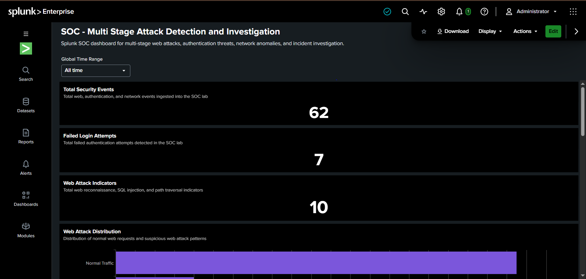
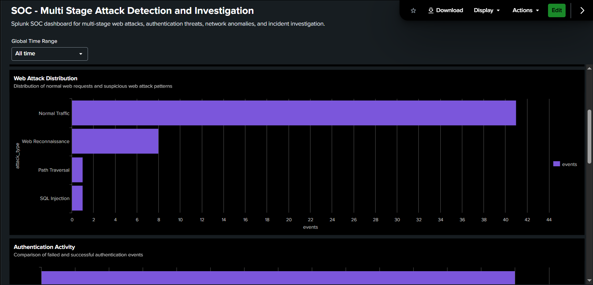
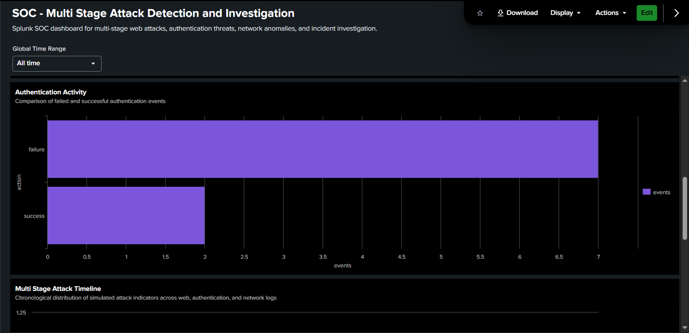
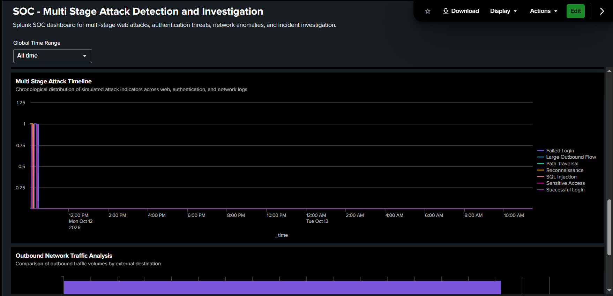
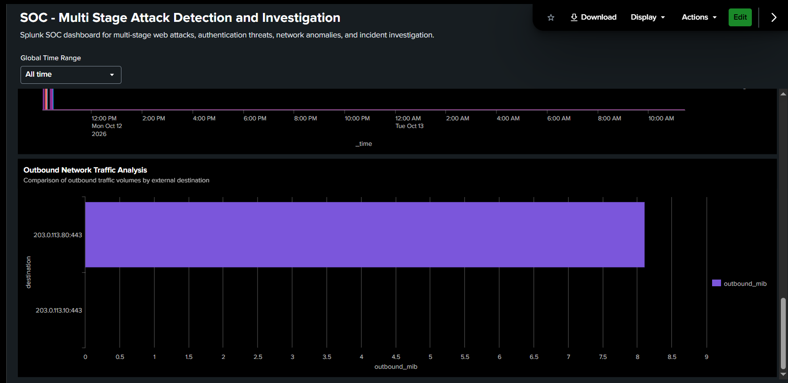

# Splunk Multi-Stage Attack Detection & SOC Investigation Lab

**A hands-on Security Operations Center project demonstrating threat detection, SPL query development, multi-source log correlation, incident investigation, and MITRE ATT&CK mapping using Splunk Enterprise.**

## Project Overview

This project simulates a multi-stage web application attack and demonstrates how a SOC Analyst can detect and investigate suspicious activity using Splunk Enterprise.

Synthetic web application, authentication, and network traffic logs are ingested into a custom Splunk index. Security detections identify suspicious requests, authentication attacks, sensitive resource access, and unusually large outbound network flows.

The project focuses on practical SOC Analyst L1 skills, including:

- Security event monitoring and analysis
- Splunk Search Processing Language (SPL)
- Detection engineering
- Web and authentication threat analysis
- Multi-source security event correlation
- Incident triage and investigation
- SOC dashboard development
- MITRE ATT&CK mapping
- Incident response documentation

## Technologies Used

| Technology | Purpose |
|---|---|
| Splunk Enterprise 10.6 | SIEM platform and security event investigation |
| Splunk SPL | Threat detection and log correlation |
| Python 3 | Synthetic security log generation |
| Windows 10 | Lab environment |
| CSV | Web, authentication, and network log datasets |
| Splunk Dashboard Studio | Security monitoring dashboard |
| MITRE ATT&CK | Threat technique mapping |
| GitHub | Project documentation and version control |

## Lab Architecture

```text
Python Log Generator
        |
        v
Synthetic Security Logs
        |
        +-- Web Application Logs
        +-- Authentication Logs
        +-- Network Traffic Logs
        |
        v
Splunk Enterprise
        |
        v
Index: soc_attack_detection
        |
        +-- SPL Threat Detections
        +-- Security Dashboard
        +-- Incident Investigation
        +-- Multi-Source Correlation
        |
        v
SOC Incident Triage
        |
        v
MITRE ATT&CK Mapping
        |
        v
Incident Response Report
```

## Dataset Overview

| Data Source | Sourcetype | Events |
|---|---|---:|
| Web Application | soc:web | 51 |
| Authentication | soc:auth | 9 |
| Network Traffic | soc:network | 2 |
| **Total** | | **62** |

All datasets are synthetic and were created for authorized cybersecurity training.

## SPL Detection Engineering

Seven SPL detection and correlation queries are included in the `detections` directory.

| Detection | Description |
|---|---|
| Web Reconnaissance | Detects repeated HTTP 404 responses |
| Web Attack Attempts | Identifies SQL injection and path traversal patterns |
| Brute Force | Detects repeated failed authentication attempts |
| Suspicious Login | Identifies successful logins following multiple failures |
| Sensitive Resource Access | Monitors requests to administrative export endpoints |
| Network Anomaly | Detects outbound traffic exceeding a lab-defined threshold |
| Attack Correlation | Reconstructs suspicious events across multiple log sources |

The thresholds are designed for the synthetic dataset and would require tuning before use in production.

## SOC Dashboard

### SOC Dashboard Screenshot




### Additional SOC Dashboard Screenshots

**Dashboard Screenshot 2**



**Dashboard Screenshot 3**



**Dashboard Screenshot 4**



**Dashboard Screenshot 5**




Developed a Splunk Dashboard Studio dashboard titled **SOC - Multi Stage Attack Detection and Investigation**.

The dashboard contains seven visualizations:

1. Total Security Events — 62
2. Failed Login Attempts — 7
3. Web Attack Indicators — 10
4. Web Attack Distribution
5. Authentication Activity
6. Multi-Stage Attack Timeline
7. Outbound Network Traffic Analysis

Dashboard and investigation evidence are available in the `Screenshots` directory.

## Simulated Incident Investigation

**Incident ID:** SOC-SPL-001

**Title:** Suspected Multi-Stage Web Application Attack and Account Misuse

**Lab Triage Priority:** High

**Suspicious Source IP:** 198.51.100.77

**Target Account:** admin

### Attack Timeline

| Time | Observed Activity |
|---|---|
| 10:03–10:10 | Web reconnaissance with repeated HTTP 404 responses |
| 10:12 | SQL injection attempt |
| 10:13 | Path traversal attempt |
| 10:15–10:21 | Seven failed administrator login attempts |
| 10:23 | Successful administrator login |
| 10:25 | Administrative customer export endpoint accessed |
| 10:27 | Large outbound network flow observed |

### Investigation Findings

The investigation identified suspicious web requests, repeated authentication failures, a successful administrator login, and subsequent access to a sensitive endpoint.

An 8.11 MiB outbound network flow occurred shortly afterward. Its relationship to the earlier application activity remains unconfirmed.

The evidence demonstrates suspicious patterns in the synthetic dataset, but does not establish a real-world compromise or confirmed exfiltration.

## MITRE ATT&CK Mapping

| Technique | ID | Detection Context |
|---|---|---|
| Active Scanning | T1595 | Suspected web endpoint enumeration |
| Exploit Public-Facing Application | T1190 | SQL injection and path traversal attempts |
| Brute Force | T1110 | Repeated failed authentication |
| Valid Accounts | T1078 | Candidate behavior; unauthorized access not confirmed |

Detailed mapping is documented in `MITRE_ATTACK_Mapping.md`.

## Incident Response Workflow

The investigation demonstrates the following SOC activities:

**Identification:** Review detection outputs and correlate suspicious events.

**Triage:** Assess the activity, available evidence, and simulated business risk.

**Investigation:** Reconstruct the attack timeline and examine relevant source IPs, accounts, endpoints, and network flows.

**Escalation:** Document findings for simulated escalation to SOC Tier 2.

**Containment Recommendations:** Validate sessions and credentials, restrict malicious activity if confirmed, and preserve relevant evidence.

**Recovery and Lessons Learned:** Improve detection coverage, logging quality, administrative activity monitoring, and incident response procedures.

## Reproducing the Lab

1. Install and configure Splunk Enterprise.
2. Run `generate_logs.py` using Python 3.
3. Locate the generated CSV datasets in `datasets/`.
4. Create a Splunk event index named `soc_attack_detection`.
5. Upload the CSV datasets using Splunk's Add Data workflow.
6. Configure CSV parsing, timestamps, and sourcetypes: `soc:web`, `soc:auth`, and `soc:network`.
7. Execute the SPL queries available in `detections/`.
8. Review the results and recreate the Dashboard Studio visualizations.
9. Follow the investigation reports to reproduce the simulated triage process.

## Repository Structure

```text
Splunk-Multi-Stage-Attack-Detection-SOC-Lab/
├── README.md
├── generate_logs.py
├── MITRE_ATTACK_Mapping.md
├── datasets/
│   ├── web.csv
│   ├── auth.csv
│   └── network.csv
├── detections/
│   ├── 01_Web_Reconnaissance.spl
│   ├── 02_Web_Attack_Attempts.spl
│   ├── 03_Brute_Force.spl
│   ├── 04_Suspicious_Login.spl
│   ├── 05_Sensitive_Resource_Access.spl
│   ├── 06_Network_Anomaly.spl
│   └── 07_Attack_Correlation.spl
├── Screenshots/
└── incident-report/
    ├── SOC-SPL-001_Triage_Report.md
    └── SOC-SPL-001_Final_Incident_Report.md
```

## Project Outcomes

- Configured a working Splunk Enterprise SIEM lab.
- Ingested and validated 62 synthetic security events.
- Developed seven SPL detection and correlation queries.
- Built a seven-panel SOC monitoring dashboard.
- Investigated suspicious activity across web, authentication, and network logs.
- Reconstructed a multi-stage incident timeline.
- Created incident triage and investigation reports.
- Documented detection coverage using MITRE ATT&CK.

## Disclaimer

This project is intended exclusively for authorized cybersecurity education, SOC training, and defensive security research.

All attack traffic, IP addresses, accounts, and investigation scenarios are synthetic. No actual customer data compromise or exfiltration is claimed.
